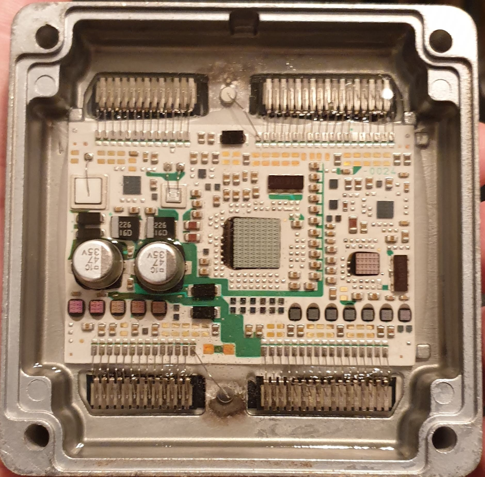
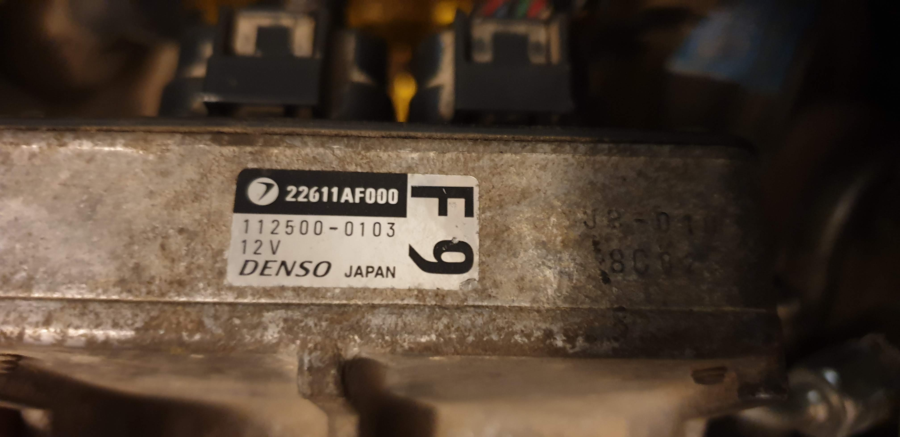
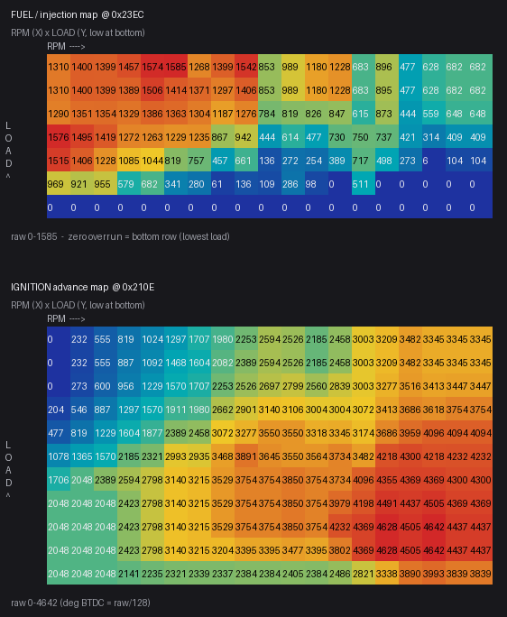

# Subaru Forester Denso ECU — firmware teardown & factory maps (`7gdaq000`)

Reverse-engineering of the 64 KB Denso engine-ECU ROM from a **2001 Subaru
Forester SF** (Australian market, naturally-aspirated **EJ202** — 2.0 L SOHC
flat-four). It exists for two
audiences:

- **Tuners** who want the **factory base maps** — the stock fuel and ignition
  tables — as a starting point for a tune, almost always on an **aftermarket /
  standalone ECU** (the factory Denso ECU can't practically be reflashed). →
  start with **[docs/aftermarket-porting.md](docs/aftermarket-porting.md)**, or
  jump to [Factory base maps](#factory-base-maps) and
  [docs/factory-tune.md](docs/factory-tune.md).
- **Engineers** reverse-engineering their own Denso ECU image from this era. →
  the [how it was done](#how-it-was-reverse-engineered) docs cover the
  processor, memory map, calibration format, table-finding method, and the
  ignition output path — reusable on similar Denso ROMs.

| | |
|---|---|
| Vehicle | Subaru Forester SF, 2001, AUS-market |
| Engine | EJ202 — 2.0 L SOHC naturally-aspirated flat-four |
| Subaru part no. | `22611AF000` |
| Denso hardware no. | `112500-0103` (`DENSO JAPAN`, 12 V) |
| Calibration ID | `7gdaq000.aus` (`.aus` = Australian market, string @ `0xEF68`) |
| Build stamp | `EGC02 / 1996-07-02` (@ `0xF800`) |
| Induction | **Speed-density** — MAP sensor, no MAF (load axis = kPa) |
| Image | 65,536 bytes, `27C512`-class EPROM, big-endian 16-bit |
| ROM md5 | `c310d4c5bbc46012b6c8b0e5c67fce05` |
| Processor | proprietary Denso 8-bit MCU (Motorola 6800/6805 lineage) |

Which number is which: `22611AF000` is **Subaru's** part number, `112500-0103`
is **Denso's** hardware number — both are part/model numbers, not a per-unit
serial. Details and board walkthrough in [docs/hardware.md](docs/hardware.md).




---

## Factory base maps

The stock tune, decoded from the ROM. **Cell values are exact; axis labels are
estimates** (the ECU scales the sensors to index the maps rather than storing
breakpoint arrays — confirm axis positions against a datalog before trusting
exact cell placement). Full numeric tables are in
**[docs/factory-tune.md](docs/factory-tune.md)**; the raw CSVs are under
[`data/`](data/).

| Map | Address | Size | Scale / units |
|---|---|---|---|
| **Ignition advance** | `0x210E` | 11 load × 19 rpm | **°BTDC = raw ÷ 128** (0–36.3°) |
| **Fuel / injection** | `0x23EC` | 7 load × 19 rpm | raw injection-quantity counts (0–1585) |
| Rev limit | `0x186A` / map `0x26BC` | — | ~6250 rpm |



Both maps are indexed **rpm × load**, and the load axis is **manifold pressure
(kPa)** — the factory ECM pinout confirms a MAP sensor and no MAF, so this is a
**speed-density** tune (build aftermarket tables on an rpm × kPa grid). The
ignition surface reads ~16° at idle, ~36° at light-load cruise, pulled to 0–4°
under high load / low rpm — the textbook spark shape and the inverse of the fuel
map. The fuel map is an **injection-quantity** map (not VE, not ms); a normalised
VE starting shape for TunerStudio/RomRaider is in
[`data/ve_table_relative.csv`](data/ve_table_relative.csv). See
[docs/factory-tune.md](docs/factory-tune.md) for the complete cell-by-cell tables
and [docs/aftermarket-porting.md](docs/aftermarket-porting.md) for how to put
them on a standalone ECU.

---

## How it was reverse-engineered

For engineers working on a similar Denso image. Everything below was established
by static analysis of the ROM; confidence is flagged throughout the docs.

| Topic | Doc |
|---|---|
| The MCU (Denso 8-bit, 6800/6805-lineage), vectors, key routines | [docs/processor.md](docs/processor.md) |
| Memory map (RAM / calibration / code / I/O registers) | [docs/memory-map.md](docs/memory-map.md) |
| Calibration format (Q12 fixed-point, framed tables, access idiom) | [docs/calibration-format.md](docs/calibration-format.md) |
| Every table found + the ignition/fuel maps | [docs/tables.md](docs/tables.md) |
| **Table roles** — each table grouped by its driving sensor | [docs/sensors.md](docs/sensors.md) |
| **Ignition output path** — advance → timer → coil output-compare | [docs/ignition-output.md](docs/ignition-output.md) |
| **ECM I/O pinout & signals** (factory service manual) | [docs/pinout.md](docs/pinout.md) |
| **Porting to an aftermarket ECU** (for tuners) | [docs/aftermarket-porting.md](docs/aftermarket-porting.md) |
| Factory base maps, full numeric tables (for tuners) | [docs/factory-tune.md](docs/factory-tune.md) |
| The physical ECU (part numbers, board, photos) | [docs/hardware.md](docs/hardware.md) |

Key method, in one line: the firmware addresses every table with the idiom
`FD B9 <table>` + `FD BB <index_var>` + a call to an interpolator, so scanning
for `FD B9` targets in `0x1800–0x36FF` yields the authoritative list of **69
tables**, and the index variable names the sensor that drives each one.

A single-file visual report is at [report.html](report.html).

### Reproduce it yourself

The scripts take **your own** ROM dump as an argument (no firmware is committed
here — supply your own).

```bash
pip install pillow numpy
python scripts/find_tables.py     path/to/rom.bin   # -> table_catalog.csv (69 tables)
python scripts/extract_maps.py    path/to/rom.bin   # -> fuel / ignition (degrees) CSVs
python scripts/analyze_roles.py   path/to/rom.bin   # -> table_roles.csv (driving input per table)
python scripts/render_heatmaps.py path/to/rom.bin   # -> PNG heatmaps
```

All maps are oriented **RPM = X (horizontal), load = Y (vertical, low load at
the bottom)**.

---

## Not included / disclaimer

- **The ROM binary is not committed.** ECU firmware is copyrighted; supply your
  own dump. `.gitignore` excludes `*.bin`.
- This is independent interpretation for research and personal tuning. No
  affiliation with Subaru or Denso. The "6800/6805-lineage" processor
  conclusion is an inference from the instruction set; several sensor identities
  and the ignition output pin are inferred (flagged per item in the docs).
- The pinout images in [docs/pinout.md](docs/pinout.md) are excerpts from the
  Subaru service manual, included for reference; the pin *data* (identities,
  voltages) is factual. Verify against your own vehicle/harness.
- A bad tune can damage an engine — a wrong spark map can cause detonation.
  Everything here is a **baseline**, not a finished calibration: verify on your
  engine (dyno + wideband + knock monitoring) and **use at your own risk.**
- Corrections and additional cal IDs welcome via issues/PRs.
