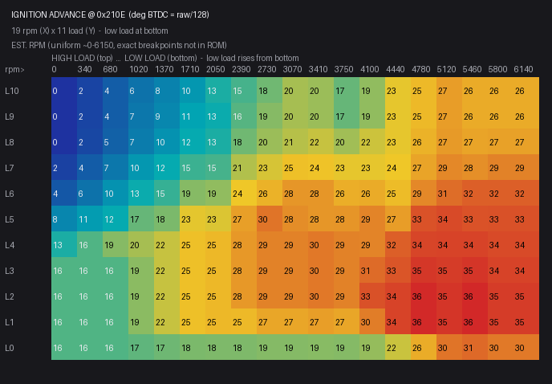
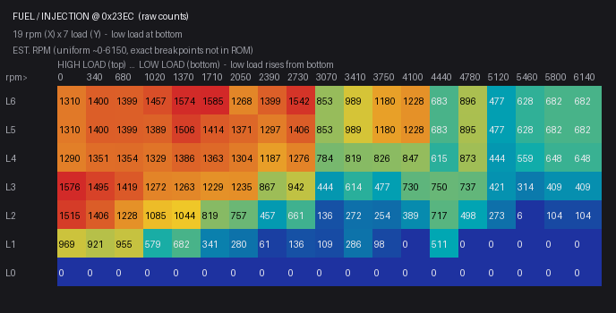

# Factory base maps — Subaru Forester SF (2001, AUS)

The stock calibration pulled straight from this ECU's ROM (`7gdaq000.aus`), for
anyone building a tune from the factory baseline. The **cell values are exact**
(decoded from the binary), but the **RPM and load axis labels are estimates**,
because the ECU computes the axis indices by scaling the sensors rather than
storing breakpoint arrays. Confirm axis positions against a datalog or timing
light before you trust exact cell placement. See [tables.md](tables.md) for the
axis discussion and the [factory map images](#heatmaps) below.

> **Load axis = manifold pressure (kPa).** This is a speed-density tune, so
> build on an rpm × kPa grid. If you are moving it onto a standalone ECU, which
> is the usual case because you cannot practically reflash the factory ECU,
> start with **[aftermarket-porting.md](aftermarket-porting.md)**.

| | |
|---|---|
| Ignition map | `0x210E` — 11 load × 19 rpm — **°BTDC = raw ÷ 128** |
| Fuel/injection map | `0x23EC` — 7 load × 19 rpm — raw injection-quantity counts |
| Rev limit | ~6250 rpm (constant `0x186A` = 6250; threshold map `0x26BC`) |
| Ignition range | 0.0 – 36.3° BTDC |
| Spark output | fires via output-compare `0x0212` — see [ignition-output.md](ignition-output.md) |

---

### Ignition advance — °BTDC

Base spark map `0x210E` (11 load rows x 19 rpm columns). Top row = highest load, bottom row `L0` = lowest load (overrun). The RPM header is a **uniform estimate**. Cell values are exact (`raw/128`).

| load\rpm_est | 0 | 340 | 680 | 1020 | 1370 | 1710 | 2050 | 2390 | 2730 | 3070 | 3410 | 3750 | 4100 | 4440 | 4780 | 5120 | 5460 | 5800 | 6140 |
|---|---|---|---|---|---|---|---|---|---|---|---|---|---|---|---|---|---|---|---|
| L10 | 0.0 | 1.8 | 4.3 | 6.4 | 8.0 | 10.1 | 13.3 | 15.5 | 17.6 | 20.3 | 19.7 | 17.1 | 19.2 | 23.5 | 25.1 | 27.2 | 26.1 | 26.1 | 26.1 |
| L9 | 0.0 | 1.8 | 4.3 | 6.9 | 8.5 | 11.5 | 12.5 | 16.3 | 18.7 | 20.3 | 19.7 | 17.1 | 19.2 | 23.5 | 25.1 | 27.2 | 26.1 | 26.1 | 26.1 |
| L8 | 0.0 | 2.1 | 4.7 | 7.5 | 9.6 | 12.3 | 13.3 | 17.6 | 19.7 | 21.1 | 21.9 | 20.0 | 22.2 | 23.5 | 25.6 | 27.5 | 26.7 | 26.9 | 26.9 |
| L7 | 1.6 | 4.3 | 6.9 | 10.1 | 12.3 | 14.9 | 15.5 | 20.8 | 22.7 | 24.5 | 24.3 | 23.5 | 23.5 | 24.0 | 26.7 | 28.8 | 28.3 | 29.3 | 29.3 |
| L6 | 3.7 | 6.4 | 9.6 | 12.5 | 14.7 | 18.7 | 19.2 | 24.0 | 25.6 | 27.7 | 27.7 | 25.9 | 26.1 | 24.8 | 28.8 | 30.9 | 32.0 | 32.0 | 32.0 |
| L5 | 8.4 | 10.7 | 12.3 | 17.1 | 18.1 | 23.4 | 22.9 | 27.1 | 30.4 | 28.5 | 27.7 | 27.8 | 29.2 | 27.2 | 33.0 | 33.6 | 33.0 | 33.1 | 33.1 |
| L4 | 13.3 | 16.0 | 18.7 | 20.3 | 21.9 | 24.5 | 25.1 | 27.6 | 29.3 | 29.3 | 30.1 | 29.3 | 29.2 | 32.0 | 34.0 | 34.1 | 34.1 | 33.6 | 33.6 |
| L3 | 16.0 | 16.0 | 16.0 | 18.9 | 21.9 | 24.5 | 25.1 | 27.6 | 29.3 | 29.3 | 30.1 | 29.3 | 31.1 | 32.8 | 35.1 | 34.7 | 35.2 | 34.1 | 34.1 |
| L2 | 16.0 | 16.0 | 16.0 | 18.9 | 21.9 | 24.5 | 25.1 | 27.6 | 29.3 | 29.3 | 30.1 | 29.3 | 33.1 | 34.1 | 36.2 | 35.2 | 36.3 | 34.7 | 34.7 |
| L1 | 16.0 | 16.0 | 16.0 | 18.9 | 21.9 | 24.5 | 25.1 | 25.0 | 26.5 | 26.5 | 27.2 | 26.5 | 29.7 | 34.1 | 36.2 | 35.2 | 36.3 | 34.7 | 34.7 |
| L0 | 16.0 | 16.0 | 16.0 | 16.7 | 17.5 | 18.1 | 18.3 | 18.3 | 18.6 | 18.6 | 18.8 | 18.6 | 19.4 | 22.0 | 26.1 | 30.4 | 31.2 | 30.0 | 30.0 |

The machine-readable version is
[`data/ignition_degrees.csv`](../data/ignition_degrees.csv). It reads about 16°
at idle, climbing to about 36° at light-load cruise and pulled back to single
digits or 0° at high load and low rpm for knock protection, which makes it the
physical inverse of the fuel map.

---

### Fuel / injection — raw counts

Base fuel map `0x23EC` (7 load rows x 19 rpm). `L0` is the zero overrun/fuel-cut row. Values are raw injection-quantity counts (not ms). The RPM header is a uniform estimate.

| load\rpm_est | 0 | 340 | 680 | 1020 | 1370 | 1710 | 2050 | 2390 | 2730 | 3070 | 3410 | 3750 | 4100 | 4440 | 4780 | 5120 | 5460 | 5800 | 6140 |
|---|---|---|---|---|---|---|---|---|---|---|---|---|---|---|---|---|---|---|---|
| L6 | 1310 | 1400 | 1399 | 1457 | 1574 | 1585 | 1268 | 1399 | 1542 | 853 | 989 | 1180 | 1228 | 683 | 896 | 477 | 628 | 682 | 682 |
| L5 | 1310 | 1400 | 1399 | 1389 | 1506 | 1414 | 1371 | 1297 | 1406 | 853 | 989 | 1180 | 1228 | 683 | 895 | 477 | 628 | 682 | 682 |
| L4 | 1290 | 1351 | 1354 | 1329 | 1386 | 1363 | 1304 | 1187 | 1276 | 784 | 819 | 826 | 847 | 615 | 873 | 444 | 559 | 648 | 648 |
| L3 | 1576 | 1495 | 1419 | 1272 | 1263 | 1229 | 1235 | 867 | 942 | 444 | 614 | 477 | 730 | 750 | 737 | 421 | 314 | 409 | 409 |
| L2 | 1515 | 1406 | 1228 | 1085 | 1044 | 819 | 757 | 457 | 661 | 136 | 272 | 254 | 389 | 717 | 498 | 273 | 6 | 104 | 104 |
| L1 | 969 | 921 | 955 | 579 | 682 | 341 | 280 | 61 | 136 | 109 | 286 | 98 | 0 | 511 | 0 | 0 | 0 | 0 | 0 |
| L0 | 0 | 0 | 0 | 0 | 0 | 0 | 0 | 0 | 0 | 0 | 0 | 0 | 0 | 0 | 0 | 0 | 0 | 0 | 0 |

The machine-readable version is
[`data/fuel_table.csv`](../data/fuel_table.csv). These are raw injection-quantity
counts (0–1585), **not milliseconds or VE**. Fuel rises with load, and the `L0`
row and the high-rpm/low-load corner read 0 for deceleration fuel cut.

> **Converting to a VE table (Speeduino / MegaSquirt / RomRaider):** this is an
> injection-quantity map, not a VE model, so there is no exact conversion. A
> normalised starting shape is in [`data/ve_table_relative.csv`](../data/ve_table_relative.csv),
> and you set the absolute level from your engine (`reqFuel`: displacement,
> injector flow, cylinders, target AFR). See [tables.md](tables.md#relative-ve).

## Heatmaps

## Using this data

Reflashing the factory ECU is not practical (no known community flash tool for
this early Denso unit), so the normal path is to **port these maps to an
aftermarket/standalone ECU**. See
**[aftermarket-porting.md](aftermarket-porting.md)** for the full recipe (load
axis, VE conversion, sensor scaling, firing order).

- Confirm the **ignition scale** (the `÷128` to °BTDC factor) against a timing
  light at a known point before you trust absolute advance numbers.
- Build on an **rpm × MAP (kPa)** grid, since this is a speed-density tune.
- A wrong spark map can cause detonation, so start conservative on timing, change
  one thing at a time, and tune on a wideband with knock monitoring.
- If you *do* attempt the factory ROM, note that there is no trivial whole-image
  checksum, but a sub-range validation routine may exist, so locate it first.
  This is advanced and unsupported. See [HANDOVER.md](../HANDOVER.md).
