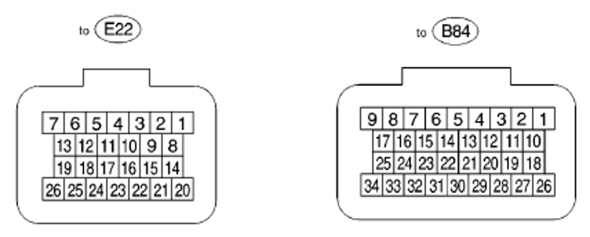
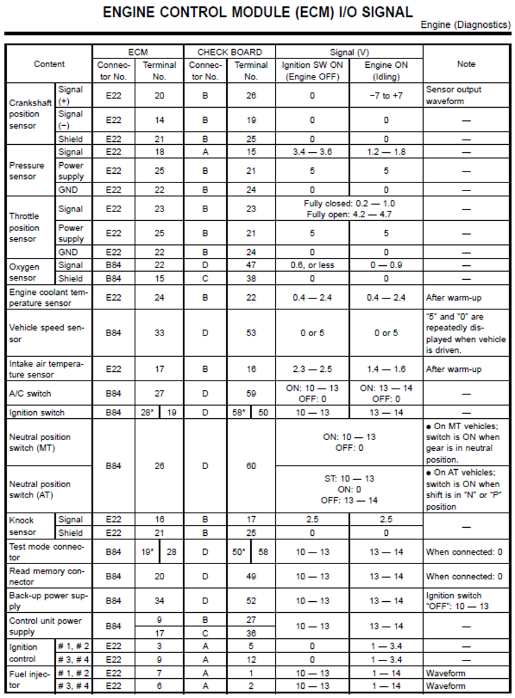
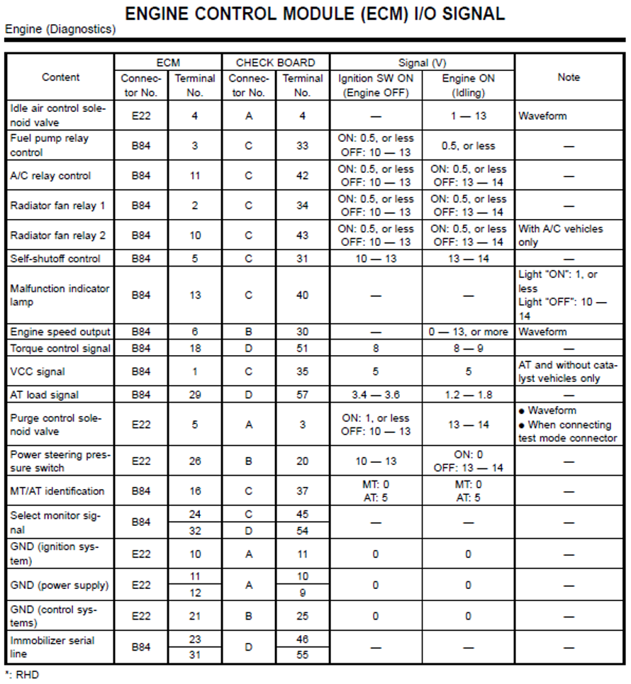

# ECM I/O pinout & signals (factory service manual)

The ECU's input/output signals, from the Subaru Forester service manual, with
the measured signal voltages. This is the Rosetta Stone for the ROM work: it
names the real sensors and actuators, confirms the load input is a **MAP
(pressure) sensor** (so the ECU is **speed-density**, not MAF), and gives signal
levels you can reuse when choosing/scaling sensors for an aftermarket ECU.

The ECM has two connectors, **E22** (26-pin) and **B84** (34-pin). The
`CHECK BOARD` columns in the manual are for the dealer diagnostic harness and are
**not needed for tuning** — only the **ECM Connector/Terminal** columns matter.
Verify connector designations against your own harness before probing.



> Source: excerpt from the Subaru Forester factory service manual, included for
> reference. Pin *data* (identities, voltages) is factual; verify against your
> vehicle.

## Inputs — sensors & switches

| Signal | ECM pin | Ign ON (eng off) | Idling | Notes for tuning |
|---|---|---|---|---|
| **Crankshaft position** (+) | E22-20 | 0 V | −7 to +7 V (AC) | **VR/reluctor** sensor — AC waveform. Set your ECU's trigger to reluctor. |
| Crankshaft position (−) | E22-14 | 0 | 0 | sensor return |
| Crankshaft position shield | E22-21 | 0 | 0 | shield/ground |
| **Pressure sensor (MAP)** signal | E22-18 | 3.4–3.6 V | 1.2–1.8 V | **Load input.** ~3.5 V ≈ atmospheric, ~1.5 V ≈ idle vacuum → **speed-density**. See [load axis](#load-axis--map). |
| MAP power | E22-25 | 5 V | 5 V | shared 5 V sensor supply |
| MAP ground | E22-22 | 0 | 0 | shared sensor ground |
| **Throttle position (TPS)** | E22-23 | closed 0.2–1.0 V / open 4.2–4.7 V | — | drives accel enrichment; 0–5 V analog |
| **Oxygen sensor** signal | B84-22 | 0.6 V or less | 0–0.9 V | **narrowband** O2 (0–1 V). Add a wideband for tuning. |
| O2 shield | B84-15 | 0 | 0 | — |
| **Engine coolant temp (ECT)** | E22-24 | 0.4–2.4 V | 0.4–2.4 V | NTC thermistor; drives warmup corrections |
| **Intake air temp (IAT)** | E22-17 | 2.3–2.5 V | 1.4–1.6 V | NTC thermistor; air-density/fuel trim |
| **Vehicle speed (VSS)** | B84-33 | 0 or 5 V | 0 or 5 V | pulsed; "5/0 repeatedly when driven" |
| **Knock sensor** signal | E22-16 | 2.5 V | 2.5 V | piezo; 2.5 V bias |
| Knock shield | E22-21 | 0 | 0 | — |
| A/C switch | B84-27 | ON 10–13 / OFF 0 | ON 13–14 / OFF 0 | — |
| Ignition switch | B84-28*/19 | 10–13 | 13–14 | *RHD pin |
| Neutral/park switch | B84-26 | ON 10–13 / OFF 0 (MT); AT: ST/N/P logic | — | MT clutch/neutral; AT in N/P |
| Test-mode connector | B84-19*/28 | 10–13 | 13–14 | grounded when the diagnostic test connector is joined |
| Read-memory connector | B84-20 | 10–13 | 13–14 | grounded when joined |
| Back-up power (KAM) | B84-34 | 10–13 | 13–14 | always-on 12 V (keep-alive memory) |
| Control-unit power | B84-9, B84-17 | 10–13 | 13–14 | switched 12 V supply |

## Outputs — injectors, ignition & actuators

| Signal | ECM pin | Ign ON (eng off) | Idling | Notes for tuning |
|---|---|---|---|---|
| **Ignition control #1, #2** | E22-3 | 0 V | 1–3.4 V | **wasted-spark pair** (cyl 1 & 2). Confirms ROM ignition output. |
| **Ignition control #3, #4** | E22-9 | 0 V | 1–3.4 V | **wasted-spark pair** (cyl 3 & 4) |
| **Fuel injector #1, #2** | E22-7 | 10–13 V | 1–14 V (waveform) | **grouped/paired** injection (1 & 2) |
| **Fuel injector #3, #4** | E22-6 | 10–13 V | 1–14 V (waveform) | grouped injection (3 & 4) |
| **Idle air control (IACV)** | E22-4 | — | 1–13 V (waveform) | PWM idle-speed valve |
| Fuel pump relay | B84-3 | ON ≤0.5 / OFF 10–13 | ≤0.5 V | low-side relay drive |
| A/C relay | B84-11 | — | ON ≤0.5 / OFF 13–14 | — |
| Radiator fan relay 1 | B84-2 | — | per state | — |
| Radiator fan relay 2 | B84-10 | — | per state | A/C-equipped only |
| Self-shutoff control | B84-5 | 10–13 | 13–14 | main-relay hold |
| Malfunction indicator lamp (MIL) | B84-13 | — | ON ≤1 / OFF 10–14 | CEL |
| Engine speed output (tacho) | B84-6 | — | 0–13 V waveform | rpm signal out |
| Purge control solenoid (EVAP) | E22-5 | ON ≤1 / OFF 10–13 | 13–14 | PWM purge |
| Power-steering pressure switch | E22-26 | 10–13 | ON 0 / OFF 13–14 | idle-up input |
| AT load signal | B84-29 | 3.4–3.6 V | 1.2–1.8 V | **mirrors MAP** — corroborates load = MAP |
| MT/AT identification | B84-16 | MT 0 / AT 5 V | — | — |
| Immobilizer serial line | B84-23, B84-31 | — | — | — |
| GND (ignition) | E22-10 | 0 | 0 | — |
| GND (power) | E22-11, E22-12 | 0 | 0 | — |
| GND (control) | E22-21 | 0 | 0 | — |





## Load axis = MAP

The only load-related analog input is the **pressure sensor** (E22-18) — there is
**no MAF / airflow meter** in the pinout. So the factory strategy is
**speed-density**: fuel and ignition are indexed by **manifold pressure × rpm**.
This resolves the ROM's load axis (`0x0966`): it is **manifold absolute pressure
(kPa)**, not an airflow count.

A rough transfer function from the two manual data points (treating ign-on ≈
atmospheric ≈ 101 kPa and idle ≈ ~30 kPa vacuum):

```
V ≈ 0.028 × kPa + 0.66      →      kPa ≈ (V − 0.66) / 0.028
```

Treat this as an **estimate** (the idle-kPa anchor is assumed). If you reuse the
factory sensor, calibrate it against two known pressures; if you fit an
aftermarket MAP sensor, just build your tables on a kPa axis and use that
sensor's own scaling. The takeaway that matters: **build the fuel and ignition
tables on a MAP (kPa) load axis.**

## What this confirms in the ROM

| Factory signal | ROM finding | Now |
|---|---|---|
| MAP sensor (load) | load variable `0x0966` | **load = MAP / kPa (speed-density)** |
| ECT sensor | `0x0924` drives 22 warmup curves | **ECT confirmed** |
| TPS | `0x090E` drives accel-enrichment group | **TPS confirmed** |
| IAT | `0x08DC` (ADC ch `0x00AA`) | **IAT** (the other analog temp input) |
| Knock | `0x08E8` drives ignition corrections | consistent with knock-based retard |
| VSS | `0x0B78` subsystem group | consistent with vehicle-speed input |
| 2× ignition outputs (wasted spark) | ignition output-compare `0x0212` | **confirmed; 2 paired channels** |
| 2× injector outputs (grouped) | injector output-compare `0x0222` | **confirmed; 2 paired channels** |
